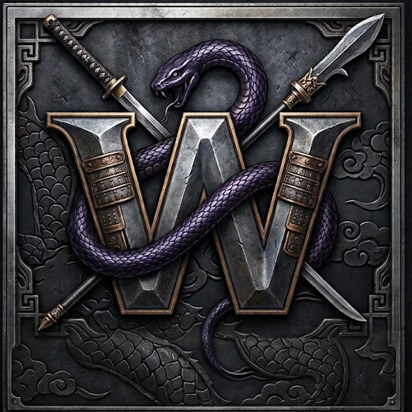

<!--
  Apresentação do projeto para o GitHub.
  Antes de publicar, troque SEU-USUARIO/SEU-REPOSITORIO pelo endereço do repositório
  e anexe à Release o zip com o nome WarriorsOrochi-Port-Windows.zip
  (o conteúdo da pasta "Warriors Orochi", sem a pasta data).
-->

<div align="center">



# Warriors Orochi — Port nativo para PC

**O clássico de PS2 rodando nativamente no Windows, por recompilação estática.**<br>
Não é emulação do jogo inteiro: o código do PS2 vira código C++ e é compilado para x64.

[](https://github.com/SEU-USUARIO/SEU-REPOSITORIO/releases/latest/download/WarriorsOrochi-Port-Windows.zip)

[](https://github.com/SEU-USUARIO/SEU-REPOSITORIO/releases/latest)
[](https://github.com/SEU-USUARIO/SEU-REPOSITORIO/releases)


[](LICENSE)

[**Baixar**](#-baixar-e-jogar) · [**Recursos**](#-recursos) · [**Controles**](#-controles) · [**Compilar**](#-compilar-a-partir-do-código) · [**Como funciona**](#-como-funciona) · [**Problemas**](#-reportar-problemas)

</div>

---

> [!IMPORTANT]
> **O jogo não vem junto.** Este projeto não contém a ISO, arquivos do disco nem código gerado a partir dele.
> Para jogar, você precisa da **sua própria cópia** do *Warriors Orochi* (USA, **SLUS-21662**).
> A tradução PT-BR feita sobre essa versão também funciona.

## 🎮 Baixar e jogar

1. **[Baixe o port (zip)](https://github.com/SEU-USUARIO/SEU-REPOSITORIO/releases/latest/download/WarriorsOrochi-Port-Windows.zip)** e extraia numa pasta com permissão de escrita (não use *Arquivos de Programas*).
2. Abra **`WarriorsOrochi-Setup.exe`**.
3. Na aba **Jogo**, escolha a sua ISO em *Selecionar outra ISO*.
4. Ajuste as abas **Gráficos**, **Áudio**, **Controles** e **Trapaças** como quiser e clique em **Salvar e jogar**.

Depois disso, basta abrir **`WarriorsOrochi.exe`**. Para trocar a ISO ou as opções, abra o Setup de novo.

### Requisitos

| | Mínimo |
|---|---|
| Sistema | Windows 10 ou 11, 64 bits |
| Processador | x64 com **AVX2** |
| Vídeo | Placa com **Direct3D 11** |
| Jogo | Sua ISO do *Warriors Orochi* (USA, SLUS-21662) |

## ✨ Recursos

| | |
|---|---|
| 🚀 **Nativo** | Código do jogo recompilado para x64; o processador vetorial VU1 também é traduzido antecipadamente para C++. |
| 🖥️ **Gráficos em alta resolução** | Renderizador baseado no GS do PCSX2 (Direct3D 11), com upscale, **16:9** e correção das linhas e emendas que aparecem ao aumentar a resolução. |
| ⚔️ **Batalhas cheias a 60 fps** | Na batalha mais lotada que testamos, o jogo se manteve a 60 fps com upscale 8x. |
| 👥 **Mais soldados na tela** | O original desenha no máximo 51 personagens; aqui o padrão é 100 (até 147), em *Gráficos → Soldados desenhados*. |
| 🔊 **Áudio** | Música e efeitos com volume ajustável no Setup. |
| 💾 **Saves seguros** | Memory card em `data\mc0`, com cópia automática do save anterior em `data\mc0-backup`. |
| 🕹️ **Controles** | Teclado e controles de jogo conectados ao Windows. O controle só age quando a janela do jogo está em foco. |
| 🧪 **Trapaças opcionais** | Invencível, vida infinita, musou infinito e pontos de crescimento infinitos. Todas vêm desligadas. |
| ⚙️ **Setup com abas** | Jogo · Gráficos · Áudio · Controles · Trapaças. |

<!-- Screenshots: aperte F12 no jogo, coloque as imagens numa pasta docs/ e descomente.
<div align="center">
   
</div>
-->

## ⌨️ Controles

| Tecla | Ação |
|---|---|
| `Enter` | Start |
| Setas | Direcional |
| `W` `A` `S` `D` | Mover |
| `X` | Confirmar |
| `C` | Voltar |
| `F10` | Alternar tela cheia / janela |
| `F12` | Salvar screenshot em `data\` |
| `Alt` + `F4` | Fechar o jogo |

A lista completa e a troca de teclas ficam na aba **Controles** do Setup.

## 🛠️ Compilar a partir do código

Coloque o projeto num **caminho curto** (por exemplo `C:\WO`): a compilação cria arquivos muito fundos e o Windows não aceita caminhos com mais de 260 caracteres. Deixe a ISO ao lado da pasta, com o nome exato `Warriors Orochi (USA).iso`.

```powershell
winget install ezwinports.make   # depois feche e abra o terminal
make deps       # instala Git, Python e VS 2022 Build Tools (C++) e baixa PS2Recomp e PCSX2 nas versões certas
make check      # confere se está tudo presente
make generate   # lê a ISO e gera o código do jogo (demora na primeira vez)
make install    # compila e monta a pasta "Warriors Orochi"
make test       # testes de regressão
```

| Comando | Para quê |
|---|---|
| `make reinstall` | Depois de alterar o código: recompila só o que mudou e troca os programas na pasta do jogo (saves e configurações ficam). |
| `make run` | Abre o Setup. |
| `make package` | Gera um zip com programa, código e logs. |
| `make help` | Lista todos os comandos. |

<details>
<summary><b>Sem make (passo a passo)</b></summary>

```powershell
git clone https://github.com/ran-j/PS2Recomp.git vendor/PS2Recomp
git -C vendor/PS2Recomp checkout eb8688b2fd191129f103a39543002c005b33409c
git clone https://github.com/PCSX2/pcsx2.git thirdparty/pcsx2
git -C thirdparty/pcsx2 checkout fd9d310ccbb6b8b62c976da8886a3c8fd3a10ff3
git -C thirdparty/pcsx2 apply ../../patches/pcsx2/0001-gs-d3d11-without-dx12-vulkan.patch
git -C thirdparty/pcsx2 apply ../../patches/pcsx2/0002-sprite-edge-inset.patch
python tools/inspect_game.py
python tools/workflow.py tools
python tools/workflow.py analyze
python tools/workflow.py generate
python tools/workflow.py native
python tools/make_helper.py install
python tools/run_regressions.py
```

Requisitos: Windows 10/11 x64 com AVX2, Visual Studio 2022 Build Tools com C++, Python 3.12+ e Git.
</details>

## 🔬 Como funciona

```text
 ISO do jogo ──► ELF do PS2 (MIPS R5900)
                     │  PS2Recomp: análise + recompilação estática
                     ▼
               código C++ gerado ──┐
                                   ├──► WarriorsOrochi.exe (x64)
 adaptadores do port (src/) ───────┤
 GS do PCSX2 (Direct3D 11) ────────┘
```

- **CPU (EE):** as funções do jogo são traduzidas para C++ e compiladas com otimização total.
- **VU1:** os microprogramas gráficos são traduzidos antecipadamente para C++ e conferidos contra um interpretador.
- **GS:** o processador gráfico é o do PCSX2 embutido, em Direct3D 11, com correções próprias para upscale.
- **IOP e áudio:** os serviços do processador de entrada e saída e o SPU2 são atendidos de forma nativa pelo runtime.
- **Correções do port:** patches versionados em `patches/` sobre versões fixas do PS2Recomp e do PCSX2.

<details>
<summary><b>Estrutura do repositório</b></summary>

| Pasta | Conteúdo |
|---|---|
| `src/` | Adaptadores do port: Setup, configurações, trapaças, distância de desenho, ponte com o GS, VU1 nativo |
| `config/` | Configuração da compilação e da recompilação |
| `tools/` | Pipeline (`workflow.py`), `make_helper.py`, geradores e testes |
| `patches/` | Correções aplicadas ao PS2Recomp e ao PCSX2 |
| `assets/` | Ícone, logo e textos que acompanham o programa |

</details>

## 🐞 Reportar problemas

Abra uma [issue](https://github.com/SEU-USUARIO/SEU-REPOSITORIO/issues) com:

- o arquivo **`data\port.log`** (registro da última execução);
- um screenshot tirado com **F12** no momento do problema (fica em `data\`);
- em que parte do jogo aconteceu.

### Limitações conhecidas

- Em resolução alta, ainda podem aparecer emendas leves em alguns efeitos de pós-processamento.
- Algumas barras de vida distantes podem aparecer sem o corpo do soldado (comportamento do original, atenuado pela opção *Soldados desenhados*).

## 📜 Licença e créditos

O código do port está sob **[GPL-3.0](LICENSE)** (veja também `NOTICES.md`).

- **[PS2Recomp](https://github.com/ran-j/PS2Recomp)** — recompilador estático de PS2 (GPL-3.0).
- **[PCSX2](https://github.com/PCSX2/pcsx2)** — renderizador GS (GPL-3.0).

*Warriors Orochi* é marca registrada da Koei Tecmo. Este é um projeto de fãs, sem fins lucrativos e sem vínculo com a Koei Tecmo ou a Sony. Nenhum arquivo do jogo é distribuído aqui.

<div align="center"><sub>Feito com 🗡️ por fãs de Musou.</sub></div>
